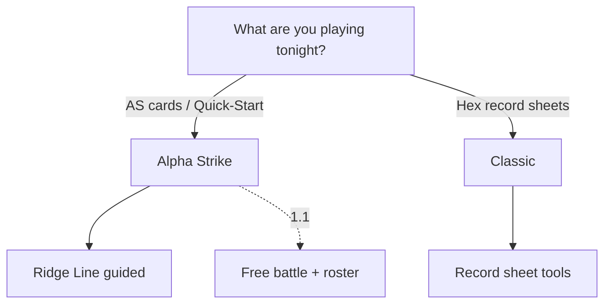

# Mech Buddy — game mode product scope

**Last updated:** 2026-11-24

| Mode | ID | Engine | Rules basis | Release intent |
|------|-----|--------|-------------|----------------|
| **Alpha Strike** | `alpha-strike` | `alphaStrikePhased` | Free Quick-Start + box cards | **1.0 MVP** |
| **Classic** | `classic-tw` | `classicTWPhased` | A Game of Armored Combat rulebook | Gated; 10-mission guided path, tools built per mission ([scope](classic/mission-path-scope.md)) |

## Player routing

## Explicitly out of v1

- Full Alpha Strike Companion / tournament rules beyond Quick-Start scope
- Networked multiplayer / shared match sync
- Official MUL bulk redistribution
- Classic full campaign / BV list building (the book's two-scenario campaign link is on the roadmap, not a full campaign system)
- Army building and Free Battle (1.1). When that work starts, look up cards on [masterunitlist.battletech.com](https://masterunitlist.battletech.com/). 1.0 playable content is Ridge Line only.

## Long-term roadmap (owner, 2026-11-24)

After each guided path, play goes beyond the tutorial. Details and the rules each step needs: [book-scenarios.md](book-scenarios.md).

| Step | Alpha Strike | Classic |
|---|---|---|
| 1. Guided path | Missions 1–5 (built) | Missions 1–10 ([scope](classic/mission-path-scope.md)), Mission 10 being the book's Final Exam |
| 2. Book scenarios | Meet and Greet, Clash of Steel (Alpha Strike box) | Trial by Fire, Divide and Conquer, with the campaign link to Final Exam |
| 3. Open play | 250 PV forces, with one of the six objectives (Raid, Control the Field, Destroy the Enemy, Hold the Fort, Breakthrough, Find the Target) rolled or picked | Any 'Mechs from the collection, with the crippled rule. Planetary conditions can be switched on |
| 4. Maps | Collection maps suggested per game, with experienced players free to pick any; later, a catalog of every known map | Same |

Rules each step adds:
- **Book scenarios:** starting damage, exit-edge wins, per-'Mech skills, initiative modifiers and carrying damage between games.
- **Alpha Strike open play:** buildings, Battlefield Support, formations, objective tokens and victory points.

## Related

- [ScreenCatalog](../../specs/screens/ScreenCatalog.md)
- [ClassicModeSpec](../../specs/features/ClassicModeSpec.md)
- [ReleaseSurfaceSpec](../../specs/ReleaseSurfaceSpec.md)
